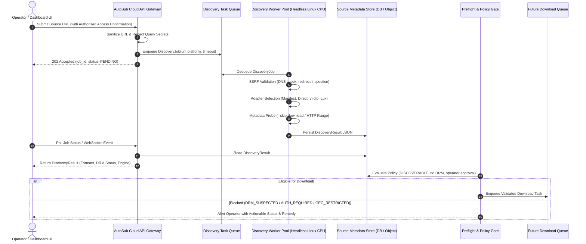

# AutoSub Cloud V2 — Discovery Integration Plan
**Work Package:** WP-DL-001  
**Deliverable:** D4 — Integration Design  
**Status:** Architecture Blueprint  
**Date:** 2026-10-16  

---

## 1. Context and Strategic Objective

The overarching vision of AutoSub Cloud V2 is an automated end-to-end localization conveyor:

```
[Video Source URL]
       │
       ▼
[Discovery Worker] ──(Metadata Only)──► [Source Metadata & Preflight]
                                                      │
                                                      ▼
                                           [Future Download Queue]
                                                      │
                                                      ▼
                                           [OCR / ASR Extraction]
                                                      │
                                                      ▼
                                       [Gemini ZH-EN Localization]
                                                      │
                                                      ▼
                                           [FFmpeg Headless Render]
                                                      │
                                                      ▼
                                           [Automated Quality Control]
                                                      │
                                                      ▼
                                           [Cloud Storage & Publishing]
```

Work Package **WP-DL-001** specifically delivers the initial **Video Source Discovery** capability. This document defines the engineering blueprint to integrate the Discovery Worker PoC into AutoSub Cloud V2 without impacting existing local AutoSub 1.10.0 production workflows.

---

## 2. Target Architecture Flow



---

## 3. Pipeline Components & Contracts

### 3.1 Dashboard UI
- **URL Intake Form**: Operator inputs target video URL, selects optional platform hint, and checks the required checkbox: `[x] I confirm legitimate authorization to probe and localize this media`.
- **Real-Time Discovery Feedback**: Displays discovery status pill:
  - `DISCOVERABLE` (Green): Title, duration, available resolutions, and recommended download engine.
  - `AUTH_REQUIRED` (Yellow): Indicates that VIP login, session cookies, or access tokens are missing. Prompts operator to configure authorized credentials in Vault.
  - `DRM_SUSPECTED` (Red): Explains that the video is protected by Widevine, FairPlay, or custom platform DRM. Prohibits automated download.
  - `GEO_RESTRICTED` (Orange): Identifies region-blocking.
  - `PROBE_ERROR` (Red): Sanitized network or parser error.

### 3.2 Discovery Queue
- **Queue Technology**: Redis Streams / Cloud Pub/Sub / RabbitMQ.
- **Job Envelope**:
  ```json
  {
    "job_id": "disc_20261016_9a4f21",
    "operator_id": "op_primary",
    "video_url": "https://www.bilibili.com/video/BV1...",
    "platform_hint": null,
    "authorized_access_confirmed": true,
    "timeout_seconds": 20.0,
    "created_at": "2026-10-16T09:30:00Z"
  }
  ```

### 3.3 Discovery Worker Pool
- **Deployment**: Headless Linux container (Alpine / Debian Slim), 100% CPU-bound, 0 GPU requirements.
- **Isolation**: Subprocess execution with strict memory caps (max 512 MB per worker) and timeouts.
- **Safety Invariant**: `download_tested` is hard-coded to `false` in this stage. No full video files or media segments are fetched or stored.
- **Multi-Engine Priority**:
  1. `ManifestDiscoveryAdapter` for direct `.m3u8` and `.mpd` links.
  2. `DirectFileDiscoveryAdapter` for `.mp4`, `.mov`, `.webm`.
  3. `YtDlpDiscoveryAdapter` for general Chinese platforms (`bilibili`, `iqiyi`, `youku`, `tencent`, `douyin`, `xigua`).
  4. `LuxDiscoveryAdapter` as fallback for specific Chinese platforms when installed.

### 3.4 Source Metadata Store
- Stored in PostgreSQL / SQLite (`source_discovery_results` table) and mirrored as an immutable artifact JSON:
  ```sql
  CREATE TABLE source_discovery_results (
      job_id VARCHAR(64) PRIMARY KEY,
      source_url_redacted TEXT NOT NULL,
      platform VARCHAR(32) NOT NULL,
      status VARCHAR(32) NOT NULL,
      recommended_engine VARCHAR(32),
      title TEXT,
      duration_seconds REAL,
      formats JSONB,
      subtitle_languages JSONB,
      authentication_required BOOLEAN NOT NULL,
      drm_status VARCHAR(32) NOT NULL,
      probe_duration_ms INTEGER NOT NULL,
      download_tested BOOLEAN NOT NULL DEFAULT FALSE,
      error_code VARCHAR(64),
      created_at TIMESTAMP WITH TIME ZONE DEFAULT CURRENT_TIMESTAMP
  );
  ```

### 3.5 Preflight & Future Download Queue Gate
The gate between Discovery and Download enforces strict validation rules:
1. **Status Gate**: Must be `status == "DISCOVERABLE"`.
2. **DRM Gate**: If `drm_status == "DRM_SUSPECTED"`, the job is hard-blocked from reaching the Download Queue.
3. **Format Selection**: Uses the probed `formats` list to select the target resolution (e.g. 1080p, 720p) and codec (`avc1` preferred for predictable FFmpeg decoding).
4. **Estimated Storage Check**: Uses `filesize_approx` or calculates `duration_seconds * expected_bitrate` to verify cloud disk capacity before enqueuing to `Future Download Queue`.

---

## 4. Operational Invariants & Security Controls

1. **SSRF Guarding**:
   - Both initial URLs and HTTP redirect targets are resolved to IP addresses and verified against loopback, private RFC1918, link-local, and cloud metadata addresses (`169.254.169.254`, `metadata.google.internal`, `100.100.100.200`).
2. **Credential Hygiene**:
   - URLs stored in database and logs are strictly scrubbed by `redact_url()`, removing tokens, session IDs, and signatures.
   - Workers never dump browser cookies or query credentials into plaintext logs.
3. **No Co-Mingling with AutoSub 1.10.0 Local Runtimes**:
   - The Discovery Worker PoC lives under `app/services/discovery/` as a modular decoupled service.
   - It introduces zero breaking changes to existing local `production_intake.py` or SQLite schema `0009_subtitle_tracks`.
4. **Rate Limiting & Proxy Rotation (Future Extension)**:
   - For platforms with aggressive IP rate limiting (e.g. Bilibili, Douyin), a forward egress proxy pool will be attached to the worker pool in future work packages.

---

## 5. Recommended Implementation Phases

- **Phase 1 (Current WP-DL-001)**: Core discovery engine, adapter architecture, SSRF protection, secret redaction, offline test suite, capability matrix.
- **Phase 2 (WP-DL-002)**: Cloud Queue integration (Redis Stream worker listener) and FastAPI Discovery Router endpoints (`/api/cloud/discovery/probe`, `/api/cloud/discovery/jobs/{id}`).
- **Phase 3 (WP-DL-003)**: Download Worker implementation for validated `DISCOVERABLE` sources with segment verification, chunked resume, and storage preflight.
