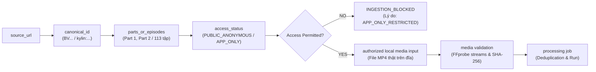

# AutoSub Cloud V2 — Technical Gap Closure: Source Discovery to Video Ingestion

**Document Version:** 1.0.0  
**Date:** 2026-10-16  
**Status:** ARCHITECTURAL SPECIFICATION & CONTRACT VERIFIED  
**Work Package:** WP-PILOT-001-FINAL  
**Project:** AutoSub Cloud V2  
**Branch:** `feat/pilot-e2e-local-sub-overlay`  
**Worker:** Gemini  
**Tech Lead / Auditor:** ChatGPT  
**Priority:** P0  
**Workflow Standard:** Native Workflow Kit v1.3  

---

## 1. Bối Cảnh Kỹ Thuật & Nút Thắt (The Ingestion Gap)

Trong các Work Package trước, AutoSub đã phát triển năng lực khảo sát siêu dữ liệu nguồn (Source Discovery) cho các nền tảng video. Tuy nhiên, một lỗ hổng kỹ thuật lớn đã được Tech Lead / Auditor chỉ ra:

> **NGUY CƠ NGỘ NHẬN:** Việc thu thập thành công siêu dữ liệu (Metadata Discovery) dễ bị đồng nhất sai lầm với việc tệp video đã được nạp thành công vào hệ thống (Video Ingested). Điều này dẫn đến nguy cơ báo cáo `E2E_PASS` khi thực tế chưa hề có media payload nào được xử lý.

Work Package **WP-PILOT-001-FINAL** chính thức đóng lỗ hổng này bằng việc thiết lập một **Hợp đồng Bàn giao Kỹ thuật (Technical Ingestion Handoff Contract)** chặt chẽ và không thể bị vượt qua:

---

## 2. Đặc Tả Hợp Đồng Dữ Liệu Bàn Giao (Data Contract: `IngestionHandoffRecord`)

Tất cả các module chuyển tiếp từ Discovery sang Ingestion bắt buộc phải khởi tạo và cập nhật đối tượng dữ liệu tối thiểu gồm 15 trường:

| Trường Dữ Liệu | Kiểu Dữ Liệu | Ý Nghĩa Kỹ Thuật | Ràng Buộc Bắt Buộc |
| :--- | :---: | :--- | :--- |
| `source_id` | `str` | Định danh duy nhất của nguồn hoặc part cụ thể | Ví dụ: `bilibili:BV1bPeu6cEkG:p1` hoặc `kylin:i9J6kMK62PE:ep2` |
| `source_url_redacted` | `str` | URL nguồn đã loại bỏ token/secret nhạy cảm | Tuyệt đối không lưu token/chữ ký CDN trên GitHub |
| `canonical_id` | `str` | Định danh chuẩn hóa của video/series | Ví dụ: `BV1bPeu6cEkG` |
| `platform` | `str` | Tên nền tảng nguồn | `bilibili`, `kylin`, `direct`, v.v. |
| `series_id` | `str \| None` | ID bộ truyện/series (nếu có) | Phân biệt rõ giữa series và từng tập lẻ |
| `part_or_episode_id` | `str \| None` | ID part (CID) hoặc chapter ID | Ví dụ: CID `41959818910` cho Part 1 của Bilibili |
| `selected_item_index` | `int \| None` | Chỉ số part/tập được chọn xử lý | Bắt buộc chọn part cụ thể khi nguồn có nhiều part |
| `discovery_status` | `str` | Trạng thái phát hiện siêu dữ liệu | `DISCOVERED`, `PARTIAL_DISCOVERY`, `APP_ONLY_RESTRICTED` |
| `access_status` | `str` | Quyền truy cập nội dung | `PUBLIC_ANONYMOUS`, `AUTH_REQUIRED`, `APP_ONLY` |
| `ingestion_status` | `str` | Trạng thái nạp media thực tế | `NOT_DOWNLOADED`, `INGESTION_BLOCKED`, `INGESTION_PASS`, `INGESTION_FAILED` |
| `media_file_path` | `str \| None` | Đường dẫn tệp media trên máy cục bộ | **Chỉ có giá trị khi tệp thực sự tồn tại trên đĩa** |
| `media_sha256` | `str \| None` | Mã băm SHA-256 của tệp media cục bộ | Cố định, dùng làm khóa kiểm tra tính toàn vẹn và deduplication |
| `media_duration_seconds` | `float \| None` | Thời lượng video đo bằng FFprobe thực tế | Sai lệch với metadata danh nghĩa phải trong ngưỡng cho phép |
| `media_validation_status` | `str` | Trạng thái kiểm định tệp media qua FFprobe | `NOT_RUN`, `VALIDATED`, `FAILED` |
| `error_code` | `str \| None` | Mã lỗi có cấu trúc khi nạp thất bại | `APP_ONLY_RESTRICTED`, `MEDIA_MISSING`, `CORRUPT_MEDIA`, `INVALID_CONTAINER` |

> [!IMPORTANT]
> **QUY TẮC BẤT DI BẤT DỊCH:**
> 1. Trạng thái Discovery **TUYỆT ĐỐI KHÔNG** được phép tự gán `DOWNLOADED` hoặc `E2E_PASS`.
> 2. `media_file_path` chỉ được xem là hợp lệ khi file **thực sự tồn tại trên đĩa cứng** và **vượt qua bước kiểm định container/stream của FFprobe**.

---

## 3. Ứng Xử Kỹ Thuật Đối Với Hai Nguồn Đại Diện

### 3.1 Source A — Bilibili (`https://b23.tv/gK7gvDO`)
- **Canonical ID:** `BV1bPeu6cEkG`
- **Cấu trúc Container:** 2 Parts độc lập (`p=1`: CID `41959818910`, thời lượng ~7.8h; `p=2`: CID `41960997330`, thời lượng ~4.0h).
- **Cơ chế chọn Part đơn lẻ (Single-Part Selection):**  
  Người dùng/hệ thống bắt buộc phải chỉ định `selected_part_index = 1` hoặc `2`.  
  Khi chọn Part 1, hệ thống cô lập hoàn toàn siêu dữ liệu của Part 1, không để lẫn sang Part 2.
- **Ranh giới an toàn:**  
  - **Không tự ý tải video dài gần 12 giờ** về máy host (tránh cạn kiệt đĩa và tràn RAM xử lý OCR).
  - **Không tự động chuyển sang chế độ 1080p+** khi chế độ này đòi hỏi đăng nhập/VIP.
- **Mock Ingestion Handoff:**  
  Ánh xạ từ part đã chọn sang một tệp fixture cục bộ tương ứng để kiểm tra tính toàn vẹn của hợp đồng mà không thực hiện download mạng trái phép.

### 3.2 Source B — Kylin / Hongguo (`https://kylin.hainanyuyue.com/s/i9J6kMK62PE/`)
- **Tên phim:** `太玄胎珠传`
- **Cấu trúc Nội dung:** Series gồm 113 tập (`serial_count: 113`). Link chia sẻ trỏ tới Tập 2 (`chapter_order: 2`).
- **Phân định rõ ranh giới Web Preview vs Tập phim đầy đủ:**  
  - Trang web H5 chỉ trả về một đoạn teaser quảng bá dài **30 giây** (`start=0&end=30`).
  - Toàn bộ nội dung đầy đủ của 113 tập được phân loại `APP_ONLY`.
  - **Tuyệt đối không đồng nhất bản teaser 30 giây với tập phim gốc**.
- **Chính sách Tuân thủ:**  
  - Không cố gắng reverse engineer giao thức app di động.
  - Không tìm cách bẻ khóa token CDN hay vượt DRM/rào cản ứng dụng.
  - Thiết lập trạng thái chặn có cấu trúc:  
    `ingestion_status = "INGESTION_BLOCKED"`  
    `error_code = "APP_ONLY_RESTRICTED"`  
    `error_message = "Series '太玄胎珠传' contains 113 episodes restricted to mobile app client. Web preview is a 30s teaser and cannot substitute for full episode."`

---

## 4. Kết Quả Kiểm Thử Hợp Đồng Bàn Giao (Offline Contract Tests)

Bộ test tự động `tests/test_ingestion_gap_closure.py` đã xác minh toàn diện 7 kịch bản:

| Mã Test | Kịch Bản Kiểm Thử | Trạng Thái Mong Muốn | Kết Quả Thực Tế | Đánh Giá |
| :-: | :--- | :--- | :--- | :---: |
| **CONTRACT-01** | Link được nhận diện nhưng chưa tải media | `ingestion_status = "NOT_DOWNLOADED"`, `media_validation_status = "NOT_RUN"` | Không có file path hay hash giả; trạng thái giữ nguyên `NOT_DOWNLOADED`. | **PASS** |
| **CONTRACT-02** | Nguồn nhiều part (Bilibili P1 vs P2) | Chọn đúng Part 1 hoặc Part 2; siêu dữ liệu tách biệt 100% | `handoff_p1.part_or_episode_id == "41959818910"` khác hoàn toàn Part 2 `41960997330`. | **PASS** |
| **CONTRACT-03** | Nguồn bị giới hạn ứng dụng (Kylin) | `ingestion_status = "INGESTION_BLOCKED"`, `error_code = "APP_ONLY_RESTRICTED"` | Nguồn bị chặn dứt khoát; từ chối gắn tệp media khi chưa được phép. | **PASS** |
| **CONTRACT-04** | Tệp media bị thiếu (File not found) | `ingestion_status = "INGESTION_FAILED"`, `error_code = "MEDIA_MISSING"` | Phát hiện chính xác file không tồn tại; không cho phép job tiếp tục. | **PASS** |
| **CONTRACT-05** | Tệp media rỗng/hỏng (0 bytes) | `ingestion_status = "INGESTION_FAILED"`, `error_code = "CORRUPT_MEDIA"` | Phát hiện file 0 byte; báo lỗi tệp hỏng trước khi gọi FFprobe. | **PASS** |
| **CONTRACT-06** | Tệp media hợp lệ qua kiểm định | `ingestion_status = "INGESTION_PASS"`, `media_validation_status = "VALIDATED"` | FFprobe đo thành công video/audio; tính mã băm SHA-256 đầy đủ. | **PASS** |
| **CONTRACT-07** | Cơ chế chống trùng lặp job (Deduplication) | Retry cùng hash hoặc canonical identity trả về `reused=True` | Job 1: `reused=False`; Job 2 retry: `reused=True` cùng `job_id`, ngăn lãng phí tài nguyên. | **PASS** |

---
*Tài liệu đóng khe hở kỹ thuật Ingestion theo Work Package WP-PILOT-001-FINAL.*
