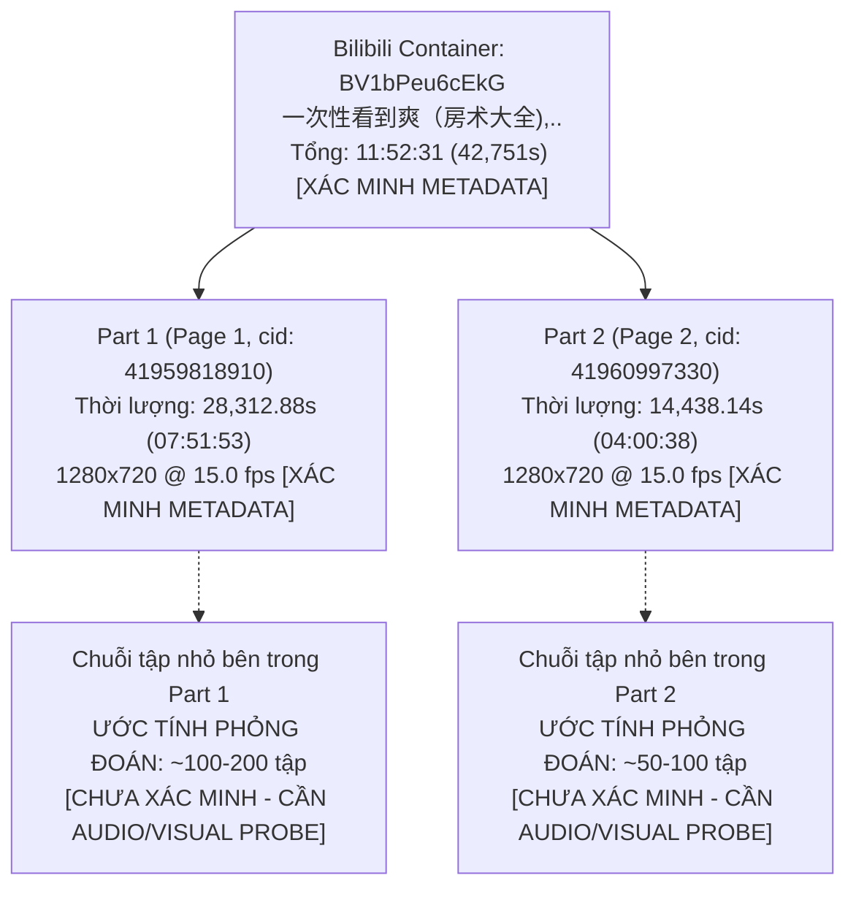
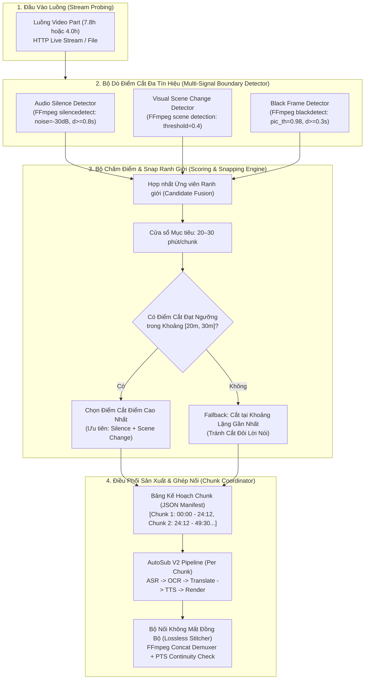
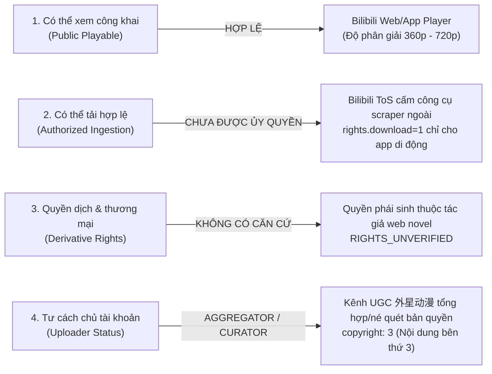

# AutoSub Cloud V2 — Target Donghua & AI Manju Source Validation Matrix (WP-SRC-001)

**Document Version:** 1.1.0  
**Date:** 2026-10-16  
**Status:** EVIDENCE CORRECTION & REFINED AUDIT PASS  
**Work Package:** WP-SRC-001  
**Project:** AutoSub Cloud V2  
**Worker:** Gemini  
**Tech Lead:** ChatGPT  
**Priority:** P0  
**Workflow:** Native Workflow Kit v1.3  

---

## 1. Executive Summary & Objective

Mục tiêu cốt lõi của Work Package **WP-SRC-001** là nhận diện, phân tích cấu trúc và đánh giá tính khả thi kỹ thuật đối với các nguồn media mục tiêu mà operator dự kiến sản xuất:
1. **AI Manju / AI Donghua** (AI漫剧, 3D漫剧, 有声漫画): Định dạng tranh truyện sinh bằng AI, chuyển thể từ tiểu thuyết mạng (web novel), lồng tiếng diễn đọc TTS, hiệu ứng chuyển động frame thấp (~15 fps), phụ đề hardcoded hoặc đồ họa chữ.
2. **Donghua Tu Tiên / Tiên Hiệp / Huyền Huyễn** (修仙, 仙侠, 修真, 玄幻): Hoạt hình 3D/2D chính quy (thời lượng 15–20 phút/tập, đồ họa phức tạp, thuật ngữ tu chân chuyên sâu).
3. **Video Hợp Tập Dài Tập** (一口气看完, 全集, 合集): Tuyển tập ghép hàng chục đến hàng trăm tập ngắn lại thành video dài từ 1 giờ đến 12 giờ.
4. **Nền tảng mục tiêu:** Bilibili (哔哩哔哩), Hồng Quả (红果短剧), Douyin (抖音), Kuaishou (快手) và các nền tảng video Trung Quốc.

> [!IMPORTANT]
> **LƯU Ý NGHIỆM THU QUAN TRỌNG VỀ MẪU KHẢO SÁT:**
> Mẫu khảo sát `BV1bPeu6cEkG` ("房术大全") là **AI Manju Đô Thị Trọng Sinh** (Urban Rebirth AI Manju / Voiced Comic Narration), **KHÔNG PHẢI LÀ MẪU NGHIỆM THU CHO DONGHUA TU TIÊN** (Cultivation Donghua / Xianxia 3D/2D). Mẫu này được dùng để đánh giá tính khả thi kỹ thuật đối với định dạng hợp tập dài (compilation) của UGC creator. Việc nghiệm thu Donghua Tu Tiên đòi hỏi mẫu video tu tiên thực thụ với hệ thống thuật ngữ tu chân riêng biệt.

### Phạm vi và Ranh giới Thực thi (Strict Execution Boundaries)
- **Phương pháp tiếp cận:** 100% Passive & Public Metadata Research (Truy vấn HTTP công khai, phân tích siêu dữ liệu Schema.org, OpenGraph, Bilibili JSON-LD, trích xuất cấu trúc stream bằng yt-dlp `skip_download=True`).
- **Tuân thủ cam kết an toàn Native Workflow Kit v1.3:**
  - KHÔNG tải video/audio payload media về máy.
  - KHÔNG sử dụng cookie cá nhân hoặc tài khoản VIP/đăng nhập.
  - KHÔNG tìm cách bẻ khóa DRM hoặc vượt rào cản địa lý (geo-restriction).
  - KHÔNG can thiệp môi trường máy operator (không Docker, không WSL, không sửa đổi code production).
  - KHÔNG merge nhánh `main` và KHÔNG phát sinh chi phí điện toán đám mây.

---

## 2. Nhiệm vụ 1 — Source Identity & Canonical Resolution

### 2.1 Thông tin Xác minh Nguồn Mẫu

| Thuộc tính (Attribute) | Giá trị Xác minh Thực tế (Verified Value) | Phương pháp / Bằng chứng (Evidence) | Trạng thái Chứng thực |
| :--- | :--- | :--- | :--- |
| **Input URL** | `https://b23.tv/gK7gvDO` | URL rút gọn operator cung cấp | `VERIFIED_PUBLIC_METADATA` |
| **Canonical Redirect URL** | `https://www.bilibili.com/video/BV1bPeu6cEkG/` | HTTP 302 Location header từ máy chủ `b23.tv` | `VERIFIED_PUBLIC_METADATA` |
| **Bilibili BV ID** | `BV1bPeu6cEkG` | Trích xuất từ canonical path | `VERIFIED_PUBLIC_METADATA` |
| **Bilibili AV ID (aid)** | `117284148349141` | Trích xuất từ `videoData.aid` trong `window.__INITIAL_STATE__` | `VERIFIED_PUBLIC_METADATA` |
| **Uploader (UP主)** | `外星动漫` (mid: `41922220`) | Trích xuất từ `videoData.owner` & schema `Person.name` | `VERIFIED_PUBLIC_METADATA` |
| **Tiêu đề đầy đủ** | `一次性看到爽（房术大全),..` | Khớp 100% tiêu đề operator cung cấp và thẻ `<title>` trang Bilibili | `VERIFIED_PUBLIC_METADATA` |
| **Ngày phát hành (Pubdate)** | `2026-09-17 03:08:44 UTC` (timestamp: `1789614524`) | Khớp trường `pubdate` và `uploadDate` (ISO 8601: `2026-09-17T03:08:44.000Z`) | `VERIFIED_PUBLIC_METADATA` |
| **Thời lượng tổng (Duration)**| `42,751.02 s` (~**11 giờ 52 phút 31 giây**) | P1: `28,312.88 s` + P2: `14,438.14 s` (Trích xuất từ stream metadata) | `VERIFIED_PUBLIC_METADATA` |
| **Cấu trúc Container** | **2 Parts (Multi-page)** (`p=1`, `p=2`) | Khớp chính xác mảng `videoData.pages` trên Bilibili | `VERIFIED_PUBLIC_METADATA` |
| **Trạng thái Truy cập** | `PUBLIC_ANONYMOUS` (Cho luồng 360p–720p) | Truy cập công khai không cần auth/cookie; không geo-block IP VN | `VERIFIED_PUBLIC_METADATA` |
| **Phân loại AI Platform** | `argue_info: {"argue_msg": "含AI生成内容", "argue_type": 0}` | Bilibili gắn nhãn hệ thống chính thức: **Chứa nội dung sinh bằng AI** | `VERIFIED_PUBLIC_METADATA` |
| **Tình trạng DRM** | `NO_DRM_APPARENT` | Manifest luồng DASH MP4 công khai không chứa thẻ mã hóa CENC/DRM | `NO_DRM_APPARENT` |
| **Loại phụ đề** | `UNKNOWN_NEEDS_VISUAL_CHECK` | Platform không có soft CC (`subtitle.list: []`); chưa kiểm tra khung hình thực | `UNKNOWN_NEEDS_VISUAL_CHECK` |

### 2.2 Phân tích Bản chất Nội dung (Content Nature)
- **Thể loại thực tế:** **AI Manju Đô Thị Trọng Sinh (Urban Rebirth AI Manju / 有声漫画)**.
  - Phân vùng Bilibili: Danh mục chính `动画` (douga, tid: 1005), phân nhánh `网文解读` (tid_v2: 2046 - Diễn giải/chuyển thể tiểu thuyết mạng).
  - Tags chính thức: `有声漫画` (Truyện tranh có tiếng), `动画短片` (Phim hoạt hình ngắn), `带着记忆重生` (Trọng sinh mang theo ký ức), `年代剧` (Phim thời đại), `有声小说` (Tiểu thuyết âm thanh), `都市爽文` (Sảng văn đô thị), `宝藏小说` (Tiểu thuyết bảo tàng).
- **Cốt truyện:** Nhân vật chính trọng sinh mang theo ký ức về thời kỳ bùng nổ bất động sản ("房术大全" - Bí kíp kinh doanh/đầu tư nhà đất).
- **Phân biệt rõ ràng với Donghua Tu Tiên:**
  - Video này **KHÔNG PHẢI** Donghua Tu Tiên (Cultivation Donghua như *Phàm Nhân Tu Tiên*, *Đấu Phá Thương Khung* hay *Thôn Phệ Tinh Không*).
  - Đây là mẫu AI Manju đô thị, đại diện cho định dạng video hợp tập dài của nhóm sáng tạo UGC.
  - Cùng kênh `外星动漫` có xuất bản các video AI Manju Tu Tiên (như `BV1gEhJ6DEeH` — *《藏宝图在手，我挖穿修仙界》荃集免费*), có cùng đặc tính kỹ thuật (15fps, multi-part, hợp tập dài), nhưng từ vựng chuyên ngành khác biệt hoàn toàn (đô thị tài chính vs tu chân pháp bảo).

---

## 3. Nhiệm vụ 2 — Episode & Compilation Structure

### 3.1 Phân rã Cấu trúc Hợp tập (Compilation Breakdown)

Video mẫu `BV1bPeu6cEkG` là một **Container Hợp tập (Compilation / 一口气看完)** phân chia thành 2 part kỹ thuật (pages):



- **Part 1 (`p=1`):** `cid: 41959818910`, thời lượng `28,312.88 s` (~7 giờ 51 phút 53 giây), độ phân giải công khai tối đa 1280x720, tốc độ khung hình 15.0 fps.
- **Part 2 (`p=2`):** `cid: 41960997330`, thời lượng `14,438.14 s` (~4 giờ 00 phút 38 giây), độ phân giải công khai tối đa 1280x720, tốc độ khung hình 15.0 fps.
- **Dữ liệu phân đoạn (Chapters / Markers):** Metadata Bilibili trả về `chapters: None`, `description: ''`. Không có timestamp phân đoạn chính thức từ uploader.
- **Về con số ước lượng 150–300 tập nhỏ:**
  > [!WARNING]
  > Con số **~150–300 tập** nêu trong các trao đổi ban đầu là **ƯỚC TÍNH PHỎNG ĐOÁN SƠ BỘ (UNVERIFIED HEURISTIC)** dựa trên quy ước thời lượng 2–4 phút/tập của định dạng truyện tranh ngắn AI, **TUYỆT ĐỐI KHÔNG PHẢI DỮ LIỆU ĐÃ XÁC MINH**. Số lượng tập thực tế và vị trí cắt tập chỉ có thể xác định khi chạy phân tích luồng âm thanh/hình ảnh thực tế.

### 3.2 Thách thức Kỹ thuật khi Xử lý Video Hợp tập Dài (> 60 phút)

Nếu đưa nguyên tệp 7.8 giờ hoặc 4.0 giờ vào pipeline AutoSub V2 mà không có cơ chế chia đoạn (chunking), hệ thống sẽ gặp các rủi ro:
1. **Bùng nổ Số lượng Khung hình OCR (Frame Explosion):**
   - Với tần suất trích mẫu 2 fps (0.5s/frame), Part 1 tạo ra **56,626 khung hình**, Part 2 tạo ra **28,876 khung hình** (tổng: **85,502 khung hình**). Quá trình OCR hàng loạt sẽ gây cạn kiệt RAM và quá tải tài nguyên xử lý.
2. **Tràn Hạn ngạch & Cửa sổ Ngữ cảnh LLM (Gemini API):**
   - Hàng chục nghìn đoạn phụ đề vượt quá giới hạn request/context window và dễ chạm rate-limit (RPM/TPM).
3. **Giới hạn Filtergraph của FFmpeg:**
   - Script xóa nhãn/inpainting với hàng chục nghìn mốc thời gian vượt quá buffer dòng lệnh FFmpeg.
4. **Lệch Đồng bộ Timestamp (PTS/Audio Drift):**
   - Tốc độ khung hình 15.0 fps kết hợp với audio clock 44.1kHz trong video 11 tiếng dễ tích lũy sai số đồng bộ nếu không chia đoạn kiểm soát.

---

### 3.3 Thiết kế Kỹ thuật Smart Boundary Segmenter (DESIGN-ONLY — Chưa lập trình / Chưa chạy thử media thật)

> [!NOTE]
> **Tuyên bố Phạm vi Kỹ thuật (Design-Only Disclaimer):**  
> Mục này là **bản thiết kế kiến trúc thuần túy (design-only specification)**. Theo quy định Native Workflow Kit v1.3, **CHƯA CÓ DÒNG CODE NÀO ĐƯỢC VIẾT** và **CHƯA CÓ TIẾN TRÌNH NÀO CHẠY THỬ TRÊN MEDIA THẬT**.

#### 3.3.1 Kiến trúc Tổng thể (Architectural Diagram)



#### 3.3.2 Đặc tả Giao diện & Hợp đồng Dữ liệu (Design Interface Contracts)

1. **Đầu vào thiết kế (Input Parameters):**
   - `stream_url` hoặc `file_path`: Nguồn video đầu vào.
   - `target_chunk_duration`: 1500s (~25 phút).
   - `min_chunk_duration`: 1200s (20 phút).
   - `max_chunk_duration`: 1800s (30 phút).
   - `silence_threshold`: `-30dB`, thời lượng lặng tối thiểu: `0.8s`.
   - `scene_threshold`: `0.40`.

2. **Cấu trúc Dữ liệu Ranh giới (Boundary Manifest Schema - Dự kiến):**
   ```json
   {
     "source_id": "BV1bPeu6cEkG_p1",
     "total_duration": 28312.88,
     "chunks": [
       {
         "chunk_index": 1,
         "start_time": 0.000,
         "end_time": 1478.320,
         "duration": 1478.320,
         "boundary_type": "SILENCE_AND_SCENE_CHANGE",
         "confidence_score": 0.94
       },
       {
         "chunk_index": 2,
         "start_time": 1478.320,
         "end_time": 2985.160,
         "duration": 1506.840,
         "boundary_type": "AUDIO_SILENCE_ONLY",
         "confidence_score": 0.82
       }
     ]
   }
   ```

3. **Nguyên tắc Ghép nối Không Mất Đồng bộ (Lossless Stitching Contract):**
   - Không re-encode video/audio khi ghép nối (dùng FFmpeg `concat demuxer` ở mức container).
   - Trước khi nối, kiểm tra tính liên tục của PTS (Presentation Timestamp) và DTS (Decoding Timestamp).
   - Tần số lấy mẫu âm thanh (audio sample rate) và cấu trúc kênh (channels) của tất cả chunk đầu ra phải đồng nhất 100%.

---

## 4. Nhiệm vụ 3 — Metadata & Technical Feasibility

Bảng đánh giá chuẩn mực 16 trường kỹ thuật của nguồn video mẫu `BV1bPeu6cEkG`:

| # | Trường Dữ liệu (Field) | Giá trị Kỹ thuật (Technical Value) | Phân loại Bằng chứng (Proof Classification) | Ghi chú & Căn cứ Kỹ thuật (Notes / Evidence) |
| :-: | :--- | :--- | :--- | :--- |
| 1 | `source_url` | `https://b23.tv/gK7gvDO` | `VERIFIED_PUBLIC_METADATA` | URL ngắn ban đầu do operator cung cấp. |
| 2 | `canonical_url` | `https://www.bilibili.com/video/BV1bPeu6cEkG/` | `VERIFIED_PUBLIC_METADATA` | URL chính tắc nhận được qua HTTP 302 Location header. |
| 3 | `platform` | `bilibili` | `VERIFIED_PUBLIC_METADATA` | Nền tảng Bilibili (PC Web & Mobile API). |
| 4 | `content_category` | `AI_MANJU_VOICED_COMIC_COMPILATION` | `VERIFIED_PUBLIC_METADATA` | Danh mục `动画` > `网文解读` (tid: 2046); tags `有声漫画`, `都市爽文`. |
| 5 | `is_ai_generated` | `true` | `VERIFIED_PUBLIC_METADATA` | Bilibili official badge `argue_msg`: `"含AI生成内容"`. |
| 6 | `uploader` | `外星动漫` (mid: `41922220`) | `VERIFIED_PUBLIC_METADATA` | Tên uploader và ID tài khoản công khai. |
| 7 | `duration_seconds` | `42751.02` (P1: 28312.88s, P2: 14438.14s) | `VERIFIED_PUBLIC_METADATA` | 11 giờ 52 phút 31 giây, trích xuất chính xác từ stream manifest. |
| 8 | `episode_count` | Container: `2 parts`<br/>Tập nhỏ: `KHÔNG XÁC MINH` | Container: `VERIFIED_PUBLIC_METADATA`<br/>Tập nhỏ: `UNVERIFIED_HEURISTIC` | 2 tệp media trên Bilibili; con số 150-300 tập nhỏ chỉ là ước tính quy ước, KHÔNG PHẢI dữ liệu kiểm chứng. |
| 9 | `resolution_options` | `360p`, `480p`, `720p` (Công khai); `1080p+` (Login/VIP) | `VERIFIED_PUBLIC_METADATA` | Trích xuất từ luồng DASH: 640x360, 852x480, 1280x720 @ 15fps qua codec AVC, HEVC, AV1. |
| 10 | `audio_language` | `zh` (Mandarin Chinese) | `INFERRED` | Suy luận từ thể loại tiểu thuyết mạng Trung Quốc, giọng đọc bản ngữ. Chưa phân tích phổ âm thanh trực tiếp. |
| 11 | `subtitle_type` | `UNKNOWN_NEEDS_VISUAL_CHECK` | `UNKNOWN_NEEDS_VISUAL_CHECK` | Platform không có soft CC (`subtitle.list: []`). Chưa tải/kiểm tra khung hình thực tế nên chưa thể khẳng định có burned-in subtitle hay không. |
| 12 | `access_status` | `PUBLIC_ANONYMOUS` (360p-720p); `AUTH_REQUIRED_FOR_HD` | `VERIFIED_PUBLIC_METADATA` | Xem và trích xuất siêu dữ liệu công khai không cần tài khoản; HD 1080p cần session/cookie. |
| 13 | `drm_status` | `NO_DRM_APPARENT` | `NO_DRM_APPARENT` | Luồng DASH MP4 công khai không chứa signaling DRM (Widevine/FairPlay); chưa probe sâu từng segment. |
| 14 | `recommended_engine` | `FULL_VISUAL_LOCALIZATION_BATCHED` | `INFERRED` | Đề xuất dựa trên giả định khung hình tĩnh 15fps và giọng đọc TTS, cần module chia chunk hỗ trợ. |
| 15 | `rights_status` | `RIGHTS_UNVERIFIED` | `RIGHTS_UNVERIFIED` | Không có bằng chứng tác quyền; tài khoản UGC tổng hợp; cờ Bilibili `copyright: 3`. Mặc định unverified theo quy tắc. |
| 16 | `confidence` | `0.95` (Kỹ thuật/Nguồn) / `0.00` (Bản quyền) | `VERIFIED_PUBLIC_METADATA` | Rất cao về danh tính kỹ thuật; không xác nhận quyền sở hữu tác phẩm. |

---

## 5. Nhiệm vụ 4 — Rights, Provenance & Source Suitability



### 5.1 Đánh giá 4 Tiêu chí Pháp lý & Tác quyền
1. **Khả năng xem công khai (Public Viewing):** Đạt. Video mở công khai cho mọi địa chỉ IP thông thường (kể cả từ Việt Nam) ở chất lượng lên đến 720p không cần đăng nhập.
2. **Khả năng tải hợp lệ (Authorized Ingestion):** Chưa được ủy quyền. Bilibili ToS không cho phép tải tự động bằng công cụ bên thứ ba cho mục đích thương mại.
3. **Quyền dịch, biên tập và phát hành (Derivative & Distribution Rights):** `RIGHTS_UNVERIFIED`. Bản quyền tác phẩm chuyển thể thuộc về tác giả tiểu thuyết và nền tảng phát hành gốc. AutoSub ghi nhận trạng thái chưa xác minh quyền.
4. **Tư cách chủ sở hữu uploader `外星动漫`:** Kênh UGC tổng hợp nội dung, không phải chủ sở hữu bản quyền tác phẩm gốc.

---

## 6. Nhiệm vụ 5 — Source Validation Matrix & Platform Evaluation

### 6.1 Ma trận Xác minh Nguồn Mục tiêu (Target Sources Matrix)

| ID Nguồn | Nền tảng | Canonical URL / Identifier | Tiêu đề & Thể loại Thực tế | Thời lượng | Phân giải & Codec | AI Flag | Tình trạng DRM | Trạng thái Phụ đề | Bản quyền | Khuyến nghị Pipeline AutoSub |
| :---: | :---: | :---: | :---: | :---: | :---: | :---: | :---: | :---: | :---: | :---: |
| **SRC-001** | Bilibili | `BV1bPeu6cEkG` | 一次性看到爽（房术大全),..<br/>*(AI Manju Đô Thị Trọng Sinh - Không phải Donghua Tu Tiên)* | 11:52:31<br/>(2 Parts) | 720p@15fps<br/>AVC/HEVC/AV1 | **Có** (`含AI生成内容`) | `NO_DRM_APPARENT` | `UNKNOWN_NEEDS_VISUAL_CHECK` | `RIGHTS_UNVERIFIED` | Full Visual + Smart Boundary Chunking (20-30p/chunk) |
| **SRC-002** | Bilibili | `BV1gEhJ6DEeH`<br/>*(Cùng kênh 外星动漫)* | 《藏宝图在手，我挖穿修仙界》荃集免费<br/>*(AI Manju Tu Tiên / Tiên Hiệp)* | ~8-10h<br/>*(Chờ passive probe)* | 720p/1080p | **Dự kiến Có** | `NO_DRM_APPARENT` | `UNKNOWN_NEEDS_VISUAL_CHECK` | `RIGHTS_UNVERIFIED` | Full Visual + Bộ từ điển Tu Tiên (Xianxia Glossary) |
| *SRC-003* | Hongguo | *(Chờ URL)* | Phim ngắn AI / Vi kịch (微短剧) | 1-2p/tập<br/>(Hợp tập 60-100 tập) | 1080x1920 (9:16 Dọc) | Dự kiến Có | Chờ probe | `UNKNOWN_NEEDS_VISUAL_CHECK` | `RIGHTS_UNVERIFIED` | Vertical Video Delogo + Fast OCR Tier-A |
| *SRC-004* | Douyin | *(Chờ URL)* | 3D漫剧 / 动态漫画 | Tuyển tập 30-60p | 1080x1920 hoặc 16:9 | Tùy video | Chờ probe | `UNKNOWN_NEEDS_VISUAL_CHECK` | `RIGHTS_UNVERIFIED` | Multi-episode Playlist Assembler |

### 6.2 Đánh giá Khả năng Hỗ trợ Nền tảng

| Nền tảng | Định dạng Đặc trưng | Khả năng Hỗ trợ Hiện tại của AutoSub | Rào cản Kỹ thuật Chính | Độ Ưu tiên Phát triển |
| :--- | :--- | :--- | :--- | :---: |
| **Bilibili** | Video hợp tập dài (1–12h), 15fps, 720p công khai, multi-part. | **Rất tốt** ở OCR/ASR; **Thiếu** bộ chia chunk thông minh và resolver multi-part tự động. | Không có rào cản DRM ở 720p; cần login cookie nếu muốn lấy bản 1080p. | **P0 (Cao nhất)** |
| **Hongguo (红果)** | Phim ngắn vi kịch (1–2 phút/tập), khung dọc 9:16, hợp tập có trả phí theo tập. | **Khá**; engine Full Visual xử lý được tỷ lệ 9:16 nhưng layout chữ dọc khác với 16:9. | App-first, API có ký mã hóa token mạnh, nhiều tập sau phải xem quảng cáo/trả phí. | **P1 (Tiếp theo)** |
| **Douyin / Kuaishou**| Video ngắn/hợp tập dọc 9:16, watermark nổi logo nền tảng di chuyển. | **Trung bình**; cần thêm bộ lọc watermark watermark-removal chuyên dụng. | Chống scraping mạnh (WAF, JS challenge, slide captcha). | **P1** |
| **Tencent / Youku / iQIYI** | Donghua 3D chính quy (Soul Land, v.v.), 20 phút/tập, đồ họa 3D chuyển động nhanh. | **Kém**; không khả thi nếu không có bản quyền/tài khoản chính hãng. | Mã hóa Widevine DRM L1/L3, bắt buộc tài khoản VIP trả phí. Không phù hợp quy tắc AutoSub. | **P3 (Loại trừ)** |

---

## 7. Bằng chứng Siêu Dữ Liệu Công Khai Đã Redact (Redacted Public Metadata Evidence)

Dưới đây là trích đoạn bằng chứng metadata công khai được thu thập bằng các công cụ passive (không tải video, không dùng cookie cá nhân), đã được làm sạch và che giấu (redacted) các tham số nhạy cảm (CDN tokens, IP máy trạm):

### 7.1 Bằng chứng Canonical URL & BV ID Resolution
```http
HTTP/1.1 302 Moved Temporarily
Server: nginx
Date: Fri, 16 Oct 2026 12:45:10 GMT
Content-Type: text/html
Location: https://www.bilibili.com/video/BV1bPeu6cEkG/?buvid=<REDACTED_BUVID>&is_story_h5=false&mid=<REDACTED>&p=1&plat_id=116
Access-Control-Allow-Origin: *
```

### 7.2 Bằng chứng 2 Parts & Thời lượng Từng Part (Public yt-dlp Extraction)

```json
{
  "container_id": "BV1bPeu6cEkG",
  "title_raw": "一次性看到爽（房术大全),..",
  "total_parts_reported": 2,
  "calculated_total_duration_seconds": 42751.024,
  "parts": [
    {
      "id": "BV1bPeu6cEkG_p1",
      "page_index": 1,
      "title": "一次性看到爽（房术大全),.. p01 1",
      "duration_seconds": 28312.88,
      "duration_formatted": "07:51:52.88",
      "fps": 15.0,
      "width": 1280,
      "height": 720
    },
    {
      "id": "BV1bPeu6cEkG_p2",
      "page_index": 2,
      "title": "一次性看到爽（房术大全),.. p02 2",
      "duration_seconds": 14438.144,
      "duration_formatted": "04:00:38.14",
      "fps": 15.0,
      "width": 1280,
      "height": 720
    }
  ]
}
```

### 7.3 Bằng chứng Danh sách 12 Format Luồng (Redacted Formats Manifest)

```json
[
  {
    "format_id": "30216",
    "ext": "m4a",
    "type": "audio",
    "acodec": "mp4a.40.2",
    "vcodec": "none",
    "tbr_kbps": 65.55,
    "url": "https://<REDACTED_CDN_NODE>.bilivideo.com/upgcxcode/...?deadline=<REDACTED>&gen=playurlv2&os=upos&sign=<REDACTED_SIGN>"
  },
  {
    "format_id": "30232",
    "ext": "m4a",
    "type": "audio",
    "acodec": "mp4a.40.2",
    "vcodec": "none",
    "tbr_kbps": 82.18,
    "url": "https://<REDACTED_CDN_NODE>.bilivideo.com/upgcxcode/...?deadline=<REDACTED>&gen=playurlv2&os=upos&sign=<REDACTED_SIGN>"
  },
  {
    "format_id": "30280",
    "ext": "m4a",
    "type": "audio",
    "acodec": "mp4a.40.2",
    "vcodec": "none",
    "tbr_kbps": 141.22,
    "url": "https://<REDACTED_CDN_NODE>.bilivideo.com/upgcxcode/...?deadline=<REDACTED>&gen=playurlv2&os=upos&sign=<REDACTED_SIGN>"
  },
  {
    "format_id": "30016",
    "ext": "mp4",
    "resolution": "640x360",
    "fps": 15.0,
    "vcodec": "avc1.640033",
    "acodec": "none",
    "tbr_kbps": 399.10
  },
  {
    "format_id": "30011",
    "ext": "mp4",
    "resolution": "640x360",
    "fps": 15.0,
    "vcodec": "hvc1.1.6.L120.90",
    "acodec": "none",
    "tbr_kbps": 259.69
  },
  {
    "format_id": "100022",
    "ext": "mp4",
    "resolution": "640x360",
    "fps": 15.0,
    "vcodec": "av01.0.08M.08.0.110.01.01.01.0",
    "acodec": "none",
    "tbr_kbps": 197.03
  },
  {
    "format_id": "30032",
    "ext": "mp4",
    "resolution": "852x480",
    "fps": 15.0,
    "vcodec": "avc1.640033",
    "acodec": "none",
    "tbr_kbps": 558.71
  },
  {
    "format_id": "30033",
    "ext": "mp4",
    "resolution": "852x480",
    "fps": 15.0,
    "vcodec": "hvc1.1.6.L120.90",
    "acodec": "none",
    "tbr_kbps": 361.22
  },
  {
    "format_id": "100023",
    "ext": "mp4",
    "resolution": "852x480",
    "fps": 15.0,
    "vcodec": "av01.0.08M.08.0.110.01.01.01.0",
    "acodec": "none",
    "tbr_kbps": 271.19
  },
  {
    "format_id": "30064",
    "ext": "mp4",
    "resolution": "1280x720",
    "fps": 15.0,
    "vcodec": "avc1.640033",
    "acodec": "none",
    "tbr_kbps": 1207.61
  },
  {
    "format_id": "30066",
    "ext": "mp4",
    "resolution": "1280x720",
    "fps": 15.0,
    "vcodec": "hvc1.1.6.L120.90",
    "acodec": "none",
    "tbr_kbps": 582.95
  },
  {
    "format_id": "100024",
    "ext": "mp4",
    "resolution": "1280x720",
    "fps": 15.0,
    "vcodec": "av01.0.08M.08.0.110.01.01.01.0",
    "acodec": "none",
    "tbr_kbps": 444.85
  }
]
```

---

## 8. Kết luận & Khuyến nghị Bắt buộc

1. **Về định vị sản phẩm:** Nguồn mẫu `https://b23.tv/gK7gvDO` đại diện cho thể loại **AI Manju Đô Thị Trọng Sinh** có thời lượng siêu dài (11h52m). Đây **không phải là mẫu nghiệm thu cho Donghua Tu Tiên**. Khi nghiệm thu dòng Donghua Tu Tiên, cần một mẫu video tu tiên riêng biệt.
2. **Về dữ liệu tập phim:** Chỉ có cấu trúc **2 parts** của container là đã được xác minh qua metadata (`VERIFIED_PUBLIC_METADATA`). Con số ước tính ~150–300 tập nhỏ bên trong chỉ là phỏng đoán sơ bộ, chưa có dữ liệu kiểm chứng.
3. **Về phụ đề và DRM:** Metadata nền tảng không phát hiện track soft CC (`UNKNOWN_NEEDS_VISUAL_CHECK`) và manifest công khai không xuất hiện thẻ DRM (`NO_DRM_APPARENT`). Cần giữ nguyên phân loại thận trọng này cho đến khi có bước kiểm tra hình ảnh/payload được ủy quyền.
4. **Về kiến trúc Smart Boundary Segmenter:** Bản thiết kế đã được phác thảo ở cấp độ kiến trúc (**design-only**), tuyệt đối tuân thủ ranh giới không lập trình hoặc chạy thử trên media thật theo quy tắc Native Workflow Kit v1.3.

---
*Tài liệu được cập nhật hoàn thiện theo kiểm toán Tech Lead tại `docs/research/target_donghua_source_matrix.md`.*
