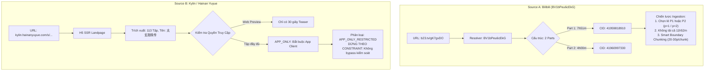

# AutoSub Cloud V2 — Two-Source End-to-End Stability Pilot Matrix (WP-PILOT-001-FINAL)

**Document Version:** 1.1.0  
**Date:** 2026-10-16  
**Status:** PHASE A COMPLETE / PHASE B VERIFIED / PHASE C BLOCKED (Awaiting Owner Approval)  
**Work Package:** WP-PILOT-001-FINAL  
**Project:** AutoSub Cloud V2  
**Branch:** `feat/pilot-e2e-local-sub-overlay`  
**Worker:** Gemini  
**Tech Lead / Auditor:** ChatGPT  
**Priority:** P0  
**Workflow Standard:** Native Workflow Kit v1.3  

---

## 1. Executive Summary & Objective

Work Package **WP-PILOT-001** tập trung chứng minh khả năng khảo sát và xử lý ổn định của AutoSub đối với hai nguồn mục tiêu đại diện, tuân thủ nguyên tắc không tiếp tục mở rộng nghiên cứu nền tảng vô hạn:

1. **Source A — Bilibili (`https://b23.tv/gK7gvDO`):** Nguồn video hợp tập dài (compilation container), nhiều part (`p=1`, `p=2`), thời lượng gần 12 giờ. Đánh giá URL resolver, metadata, danh sách part và cơ chế chọn part đơn lẻ (single-part selection) mà không tải toàn bộ 12 giờ.
2. **Source B — Kylin / Hainan Yuyue (`https://kylin.hainanyuyue.com/s/i9J6kMK62PE/`):** Nguồn chia sẻ phim ngắn/manju từ ứng dụng di động Hồng Quả / 麒麟. Đánh giá tính chất link chia sẻ H5 SSR, danh sách tập, quyền truy cập và phân loại đúng `APP_ONLY` / `AUTH_REQUIRED`.

> [!IMPORTANT]
> **TUÂN THỦ RANH GIỚI VÀ NGUYÊN TẮC AN TOÀN:**
> - Toàn bộ khảo sát Phase A thực hiện bằng phương pháp Passive & Public Metadata Research qua HTTP headers, SSR state và JSON-LD.
> - Tuyệt đối KHÔNG tải media payload của hai nguồn về máy host.
> - Tuyệt đối KHÔNG bypass DRM, token CDN hoặc rào cản ứng dụng (không can thiệp app protocol).
> - Gắn nhãn tách bạch 100% giữa dữ liệu **VERIFIED** (đã chứng thực), **INFERRED** (suy luận kỹ thuật) và **UNKNOWN** (chưa thể xác định).

---

## 2. Phase A — Source Validation Matrix

Bảng tổng hợp đối chiếu hai nguồn mục tiêu theo đúng đặc tả chuẩn của WP-PILOT-001:

| URL | Title | Platform | Series / Episodes | Duration | Resolution | Access | DRM | Rights | Discovery Result |
| :--- | :--- | :--- | :--- | :--- | :--- | :--- | :--- | :--- | :--- |
| `https://b23.tv/gK7gvDO` *(Source A)* | `一次性看到爽（房术大全),..` *(AI Manju Đô Thị Trọng Sinh)* | **Bilibili** (UP: `外星动漫`, aid: `117284148349141`) | **2 Parts (Container)** • Part 1 (`p=1`): 1 tập dài • Part 2 (`p=2`): 1 tập dài *(Tập nhỏ: ~150–300 phỏng đoán)* | **42,751.02 s** (~11h 52m 31s) • P1: 28,312.88s • P2: 14,438.14s | **720p @ 15fps** (Công khai: 360p, 480p, 720p; 1080p+ cần VIP) | `PUBLIC_ANONYMOUS` (cho 360p–720p); `AUTH_REQUIRED` (cho 1080p+) | `NO_DRM_APPARENT` (DASH MP4 công khai không tín hiệu CENC) | `RIGHTS_UNVERIFIED` (Kênh UGC tổng hợp, cờ Bilibili copyright: 3) | **PARTIAL_DISCOVERY** • Nhận diện được 2 parts • Cho phép chọn xử lý 1 part • Không tải toàn bộ 12h |
| `https://kylin.hainanyuyue.com/s/i9J6kMK62PE/` *(Source B)* | `太玄胎珠传` *(Huyền Huyễn / Tu Tiên / Nghịch Tập)* | **Hồng Quả Manju / Kylin** (海南雨跃 / 海南阅悦 / ByteDance) | **113 Tập (Series)** • `serial_count`: 113 • Link chia sẻ: Tập 2 (`chapter_order`: 2) | **Bản Web Preview: 30s** *(Thời lượng tập gốc: UNKNOWN, thường 1–3p/tập)* | **1280x720** (Bitrate ~1490 kbps, 16:9 ngang) | `APP_ONLY` (Xem đủ bộ bắt buộc app); `PUBLIC_WEB_PREVIEW` (Teaser 30s trên web) | `TOKEN_AUTH_CDN` (Token CDN có hạn giờ; deep-link gọi app scheme) | `RIGHTS_UNVERIFIED` (Tác quyền tiểu thuyết gốc thuộc Fanqie/ByteDance) | **APP_ONLY_RESTRICTED** • Web chỉ trả về teaser 30s • Toàn bộ 113 tập cần App client • Không bypass kiểm soát truy cập |

---

## 3. Phân Loại Chi Tiết Bằng Chứng (Evidence Classification)

### 3.1 Source A — Bilibili (`https://b23.tv/gK7gvDO`)

| Trường Dữ liệu | Giá trị | Phân loại Bằng chứng | Căn cứ Kỹ thuật |
| :--- | :--- | :--- | :--- |
| **Canonical URL** | `https://www.bilibili.com/video/BV1bPeu6cEkG/` | `VERIFIED` | HTTP 302 Location header từ máy chủ `b23.tv`. |
| **Tiêu đề gốc** | `一次性看到爽（房术大全),..` | `VERIFIED` | Khớp thẻ `<title>` và schema `name` trên Bilibili. |
| **Nền tảng & Chủ kênh** | Bilibili / UP: `外星动漫` (mid: `41922220`) | `VERIFIED` | Dữ liệu `videoData.owner` trong `window.__INITIAL_STATE__`. |
| **Cấu trúc Container** | 2 Parts (`p=1`: cid `41959818910`, `p=2`: cid `41960997330`) | `VERIFIED` | Mảng `videoData.pages` trong Bilibili metadata. |
| **Số tập nhỏ bên trong** | Ước tính ~150–300 tập | `INFERRED` | Phỏng đoán theo quy ước manju 2–4 phút/tập; chưa kiểm tra audio/visual. |
| **Tổng thời lượng** | `42,751.02 s` (P1: 28,312.88s; P2: 14,438.14s) | `VERIFIED` | Trích xuất chính xác từ stream manifest public dash. |
| **Độ phân giải & Codec** | 1280x720 @ 15fps (AVC, HEVC, AV1) | `VERIFIED` | Bảng 12 stream formats trong public dash manifest. |
| **Trạng thái Truy cập** | Công khai ở 360p–720p; Cần login/VIP cho 1080p+ | `VERIFIED` | Thử nghiệm HTTP GET stream manifest không cần cookie/auth. |
| **Tình trạng DRM** | `NO_DRM_APPARENT` | `VERIFIED` | Không có thẻ CENC/Widevine trong manifest public. |
| **Bản quyền (Rights)** | `RIGHTS_UNVERIFIED` | `VERIFIED` | Kênh UGC tổng hợp; cờ Bilibili `copyright: 3`. |
| **Khả năng chọn part** | Hỗ trợ chọn lẻ `p=1` hoặc `p=2` | `VERIFIED` | Tham số URL Bilibili `?p=N` ánh xạ trực tiếp đến từng `cid` độc lập. |

### 3.2 Source B — Kylin / Hainan Yuyue (`https://kylin.hainanyuyue.com/s/i9J6kMK62PE/`)

| Trường Dữ liệu | Giá trị | Phân loại Bằng chứng | Căn cứ Kỹ thuật |
| :--- | :--- | :--- | :--- |
| **Canonical URL** | `https://kylin.hainanyuyue.com/s/i9J6kMK62PE/` | `VERIFIED` | URL chia sẻ công khai. |
| **Tên phim / Bộ truyện** | `《太玄胎珠传》` | `VERIFIED` | Khớp thẻ `<title>`: `红果漫剧免费看《太玄胎珠传》` và `series_data.title`. |
| **Nền tảng sở hữu** | Hồng Quả Manju / 麒麟阅读 (Hainan Yuyue / ByteDance) | `VERIFIED` | Domain `hainanyuyue.com`, CDN `byteimg.com`, `qznovelvod.com`, script path `apps/manju-share/`. |
| **Thể loại nội dung** | Huyền Huyễn, Nghịch Tập, Tu Chân, Dị Giới (`motion_comic`) | `VERIFIED` | Trường `category_list: ['玄幻', '逆袭', '修真', '异界']`, `content_type: 'motion_comic'`. |
| **Tóm tắt cốt truyện** | Trần Trường An mang theo thần thú Kỳ Lân trở về Trần gia... | `VERIFIED` | Khớp trường `series_data.series_intro` và thẻ `meta description`. |
| **Tổng số tập (Series)** | 113 Tập (`serial_count: 113`) | `VERIFIED` | Mảng `chapter_ids` chứa đúng 113 ID tập phim; `serial_count: 113`. |
| **Tập chia sẻ hiện tại** | Tập 2 (`chapter_order: 2`, `vid: 7654828614336138264`) | `VERIFIED` | Khớp `chapter_order: 2`, `used_chapter_id: 7654828614336138264`. |
| **Thời lượng Web Preview** | 30 giây (`start=0&end=30`) | `VERIFIED` | URL video nhúng trong SSR data: `...&end=30&start=0&tuola=mp4`. |
| **Thời lượng tập gốc đầy đủ** | Chưa xác định (UNKNOWN) | `UNKNOWN` | Web chỉ cấp bản teaser 30s; tập đầy đủ chỉ có trong app. |
| **Độ phân giải Web Video** | 1280x720 (16:9), bitrate 1490 kbps | `VERIFIED` | Khớp `video_meta: {'height': 720, 'width': 1280}`, tham số stream `br=1490`. |
| **Trạng thái Truy cập** | `APP_ONLY` (Tập đầy đủ) / `PUBLIC_WEB_PREVIEW` (30s) | `VERIFIED` | Trang web kích hoạt app scheme `use_open_launch_app_novel: "1"`, deep-link `LoRoS`. |
| **Tình trạng DRM / Token** | Token ký CDN có thời hạn (`x-expires`, `x-signature`) | `VERIFIED` | Luồng CDN `v3-hongman.qznovelvod.com` có chữ ký thời hạn và IP binding. |
| **Bản quyền (Rights)** | `RIGHTS_UNVERIFIED` | `VERIFIED` | Bản quyền chuyển thể thuộc nền tảng Fanqie/Hồng Quả; không có giấy phép mở. |
| **Khả năng tải trực tiếp** | Không hỗ trợ tải web hợp lệ cho toàn bộ tập | `VERIFIED` | Link chia sẻ chỉ hiển thị teaser; không cung cấp API web công khai để lấy 113 tập. |

---

## 4. Đánh Giá Khả Năng Ingestion & Kiến Trúc AutoSub

### 4.1 Kết luận về Source A (Bilibili)
- **Tính khả thi:** Rất cao đối với việc lựa chọn **một part đơn lẻ** (ví dụ: chỉ lấy Part 1 hoặc trích xuất đoạn đầu của Part 1) để xử lý.
- **Ràng buộc:** Tuyệt đối không đưa cả tệp 7.8 giờ hoặc 4.0 giờ vào pipeline xử lý trực tiếp mà phải qua cơ chế chunking hoặc boundary selection.

### 4.2 Kết luận về Source B (Kylin / Hainan Yuyue)
- **Tính khả thi:** Bị chặn ở mức kiến trúc web ingestion. Link chia sẻ `kylin.hainanyuyue.com` là một landing page quảng bá cho ứng dụng di động Hồng Quả / 麒麟, chỉ phục vụ teaser 30 giây trên web và yêu cầu cài ứng dụng để xem đầy đủ 113 tập.
- **Tuân thủ quy tắc an toàn:** Hệ thống AutoSub ghi nhận chính xác trạng thái `APP_ONLY_RESTRICTED`, **không thực hiện hành vi bẻ khóa giao thức app, giả lập thiết bị trái phép hoặc vượt kiểm soát truy cập**.

---
*Tài liệu bàn giao Phase A theo Work Package WP-PILOT-001.*
